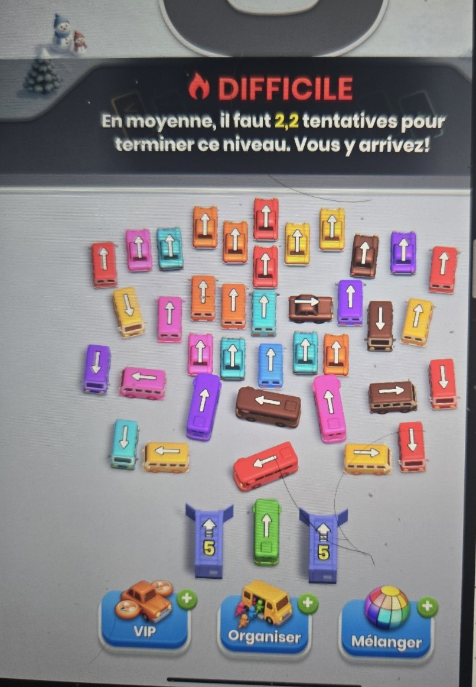
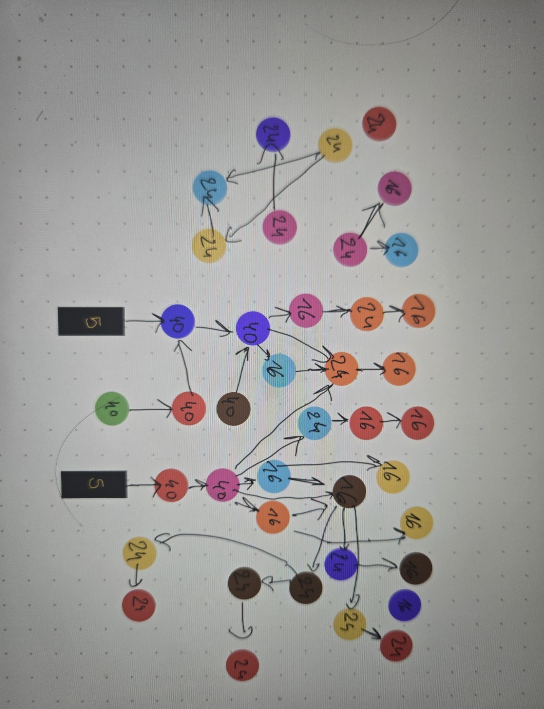

# Bus Fever Party level 34 IMPOSSIBLE
Au début, j'arrivais juste pas a terminer le niveau 34 de Bus Fever Party (même après une quinzaine de parties). Du coup, je me suis demandé si j'étais juste stupide ou alors si le niveau n'avait tout simplement pas de solution sans passer par un bonus payant et plutôt que de continuer à deviner, j'ai écrit un programme qui est censé essayer (eh oui, je ne suis pas un développeur de génie) toutes les façons de jouer ce niveau, et apparemment le niveau est impossible.

## Le point de départ
Ce niveau m'a littéralement obsédé. Après de nombreux essais sur ce niveau, impossible de le terminer sans utiliser de bonus. Le jeu le présente pourtant comme « difficile » mais sans plus, et affirme qu'il faut en moyenne 2,2 tentatives pour en venir à bout. Deux explications étaient possibles. Soit je jouais mal, soit le niveau est construit pour pousser à dépenser des pièces. D'abord, j'ai décidé de regarder des tutos youtube (eh oui, j'étais obsédé à ce point là mdr) puis comme personne n'y arriavit (même dans les tutos), j'ai décidé de laisser une machine essayer toutes les combinaisons.

## Comment fonctionne le jeu
Un parking est rempli de véhicules colorés, chacun orienté dans une direction. Toucher un véhicule le fait sortir du parking, à condition que rien ne lui barre la route. Il va alors se garer sur l'une des quatre places de chargement, en commençant par celle de gauche. Devant ces places tourne une boucle de passagers répartis en rangées de quatre de la même couleur. Chaque rangée monte dans un véhicule de sa couleur s'il lui reste de la place. Un véhicule plein s'en va et libère sa place. La boucle contient 35 rangées et les suivantes attendent dehors et entrent dès qu'une rangée embarque. La partie est perdue quand les quatre places sont occupées par des véhicules qu'aucun passager de la boucle ne peut remplir. Plus rien ne bouge.



Sur la capture, on voit le niveau au départ soit une quarantaine de véhicules avec leur flèche, les deux conteneurs marqués « 5 » en bas de part et d'autre du bus vert, et les trois bonus (VIP, Organiser, Mélanger). Le jeu le classe « Difficile » avec 2,2 tentatives en moyenne. (Faites pas attention aux quelques cheveux que j'ai perdu durant le processus).

## Le relevé du niveau
J'ai tout relevé à la main, ça m'a pris peut être 4 ou 5h:
- 41 véhicules visibles, avec leur couleur et leur taille (16, 24 ou 40 places) (8 ne sont pas visibles).
- qui bloque qui dans le parking, sous forme d'un graphe de dépendances.
- 130 rangées de passagers dans leur ordre d'arrivée avec 35 déjà dans la boucle, 74 en attente du côté gauche, puis au moins 21 du côté droit (un certain nombre non visible car il faut débloquer la situation pour y avoir accès (à voir plus bas)).
- deux conteneurs de cinq véhicules chacun. On connaît seulement le premier de chaque (un bus bleu foncé à gauche, un bus rouge à droite).
Les quatre autres véhicules de chaque conteneur sont invisibles. Plutôt que de les inventer, je les ai traités comme des sortes de jokers. À leur sortie, le programme essaie pour chacun toutes les couleurs et toutes les tailles possibles, et retient celle qui l'arrange le plus. Autrement dit, on leur laisse le bénéfice du doute. Il manque aussi des passagers. Au-delà d'un certain point, la file d'attente n'est plus visible. Ces passagers cachés arrivent forcément après ceux qu'on a notés. Le programme se fixe donc un objectif plus modeste que la victoire, qui est de faire entrer dans la boucle tous les passagers connus. Si c'est déjà impossible, la victoire l'est aussi, puisqu'on n'atteindra jamais les suivants.



Voici le schéma que j'ai fait. Chaque pastille correspond à un véhicule, avec sa couleur et son nombre de places. Une flèche de A vers B signifie que A est bloqué par B, autrement dit que B doit partir avant que A puisse bouger.
- Les deux pavés « 5 » sont les conteneurs. Le premier véhicule de celui de gauche est un bus bleu foncé, déjà sorti au début mais bloqué par le bus violet. Celui de droite commence par un bus rouge.
- Le bus violet est au centre d'une longue chaîne. Pour le libérer, il faut d'abord faire partir sept véhicules, qui ont eux-mêmes leurs propres bloqueurs.
- Le bus vert, tout en bas, ne peut partir qu'après le bus rouge, qui attend le bus bleu foncé, qui attend lui-même le bus violet.

## Ce qu'a fait le programme
À chaque étape, le seul choix du joueur est le véhicule à toucher. Tout le reste en découle comme la place où il se gare, les passagers qui montent, ceux qui entrent dans la boucle. Le programme essaie chaque coup possible, puis chaque coup suivant, et ainsi de suite. Quand deux suites de coups différentes mènent exactement à la même situation, il ne l'explore qu'une seule fois. C'est ce qui rend la recherche faisable. Sans cette précaution, le nombre de parties à examiner serait astronomique. Les premières versions n'aboutissaient pas. Elles s'arrêtaient au bout de deux millions de situations sans rien conclure.

## Le résultat
```
Recherche exhaustive : aucune solution dans ce modele.
Meilleure progression : 90 rangees embarquees
Etats explores : 23560830
```
La version finale a exploré 23 560 830 situations, dont environ 11 millions de différentes, et s'est arrêtée parce qu'il ne restait plus rien à essayer. Aucune ne permet de faire entrer tous les passagers connus dans la boucle. Le contenu caché des conteneurs n'y change rien, puisque le programme a essayé toutes les couleurs et toutes les tailles possibles pour ces véhicules.
Voici la meilleure situation atteinte, après vingt coups:
| Place | Véhicule | Remplissage |
|---|---|---|
| 1 | van orange | 12 / 24 |
| 2 | van rouge | 0 / 24 |
| 3 | voiture rouge | 0 / 16 |
| 4 | van marron | 20 / 24 |
La boucle est pleine, avec 35 rangées sur 35, dont 10 vertes et 19 bleu foncé. Trois rangées attendent encore dehors. Aucun des quatre véhicules garés ne trouvera de passagers, car tous les passagers rouges et orange connus ont déjà été utilisés, et il n'y a plus de marron en vue. La sortie complète du programme est dans [resultat.txt](resultat.txt).

## Pourquoi ça bloque
Tout tourne autour du bus violet qui bloque le bus bleu foncé (la clé du niveau). Pour le libérer, il faut d'abord sortir toute une série de véhicules, parmi lesquels cinq rouges et quatre orange. Ensemble, ils réclament 26 rangées de passagers rouges et 20 d'orange. Le niveau n'en propose que 10 et 7 parmi les passagers connus. Une bonne partie de ces véhicules finit donc garée sur les places sans jamais se remplir, et quatre places, ça se remplit vite. Tant que le bus violet est coincé, tout ce qui se trouve derrière lui l'est aussi : le bus bleu foncé, puis le bus rouge, puis le bus vert. Les 10 rangées vertes et les rangées bleu foncé restent alors dans la boucle sans pouvoir embarquer, et l'étouffent. Une vérification le confirme. Si l'on fait comme si le bus bleu foncé n'était pas bloqué par le violet, le programme trouve une solution en moins de cent étapes.

## Problème
Je ne suis qu'un humain et j'ai mis du temps à répertorier les 41 véhicules puis toutes les dépendances. Je n'ai pas non plus été très sérieux dans le travail. Il est donc possible qu'il manque des dépendances ou que certaines soient fausses. Une flèche en trop sur le schéma ou une rangée de passagers mal comptée suffirait à fausser le résultat, surtout autour du bus violet. Si vous avez ce niveau sous la main et que vous repérez une erreur, ouvrez une *issue*.

## Conclusion
Si le relevé est juste, le niveau 34 ne peut pas être terminé sans bonus et ce n'est pas une question d'habileté ou de faculté de raisonnement. Néanmoins, il reste à savoir si c'est voulu par les devs pour enclencher le pay to win.

## Lancer le programme
Il faut Java 17 ou plus récent, et rien d'autre.
```bash
javac -encoding UTF-8 -d out src/puzzle/PuzzleSolver.java
java -Xmx20g -Xss256m -cp out puzzle.PuzzleSolver
```
La recherche complète demande beaucoup de mémoire, d'où le `-Xmx20g`. On peut passer en argument le nombre maximal d'états à explorer (100 millions par défaut). Le niveau est décrit dans la méthode `createLevelBusFever()` de [PuzzleSolver.java](src/puzzle/PuzzleSolver.java). Pour en modéliser un autre, il suffit d'y déclarer les véhicules, leurs dépendances et les passagers.
